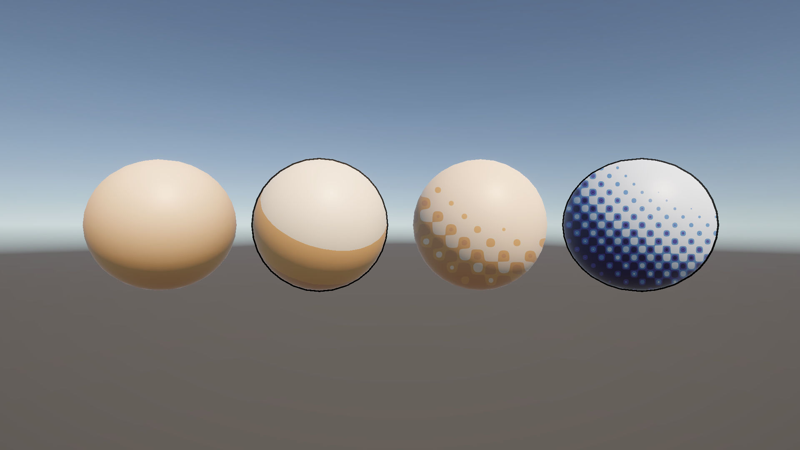

# はじめに
プログラムワークショップIVの管理用です

# 結果画像

- 工夫した点：授業で作った3つ（ランプ／トゥーン＋輪郭線／疑似ハーフトーン）に加えて、4つ目の球を追加。寒色4段階のランプテクスチャ(night_gradient.png)を自作し、ハーフトーンの振幅と網点の解像度を変え、さらに背面法の輪郭線マテリアルを重ねて組み合わせた

# 進め方

- 本リポジトリをforkしてください
- fork先のリポジトリを更新してください
- Unityのプロジェクトをsrc内で進めてください
- 結果を画面キャプチャして、画像としてリポジトリに追加して、上記のリンクから見られるようにしてください
- 完成したら本リポジトリのmainブランチにpull requestを投げてください
